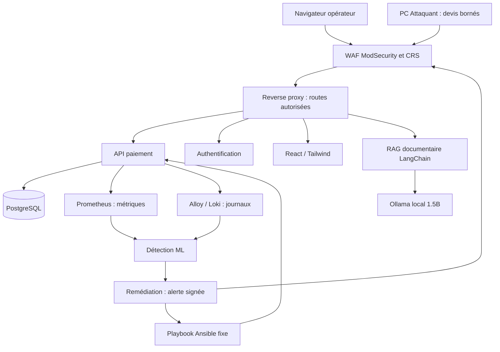

# Architecture minimale réalisable en quatre jours

## Implantation
PC Hôte Windows 10/11 avec droits administrateur, virtualisation, Docker Desktop
WSL2 et Ubuntu. Minimum du sujet : 4 cœurs, 16 Go RAM, 50 Go SSD libres ;
32 Go et 100 Go donnent une marge utile. L'ensemble doit être mesuré sur votre PC.
L'IA peut consommer plusieurs Go ; la déplacer sur le troisième PC si nécessaire.
Pas de Kubernetes, de cluster Kafka ou d'Elastic Stack pour ce prototype.

PC Attaquant : second poste, uniquement le client de charge Python, connecté
au PA Windows du groupe. PC IA optionnel : uniquement Ollama et son API,
filtrée pour le Hôte. L'assistant RAG et la recherche documentaire restent sur Hôte.

## Transaction métier
L'opérateur alice paie le compte marchand. Les montants sont des entiers en
centimes, de 1 à 100000 ; pas de carte, d'IBAN ni de paiement externe.
Le registre part de 100000 centimes sur chaque compte. Débit, crédit et transaction
sont validés ensemble. Le total doit toujours rester 200000.
Un couple clé d'idempotence/contenu identique renvoie la transaction existante.
Réutiliser la même clé pour un autre contenu renvoie 409.
Le backend PostgreSQL verrouille les comptes dans un ordre déterministe ;
SQLite sert uniquement aux tests natifs. Les tests SQLite ne valident pas PostgreSQL.

## Scénario de disponibilité retenu
La création de devis occupe 0,6 seconde une capacité aval simulée de quatre
opérations partagée avec les paiements. Le service est réellement saturable,
mais cette latence est une faiblesse pédagogique volontaire, documentée.
La charge, au maximum 20 requêtes/s, 12 simultanées, 35 secondes, ne vise ni
l'OS, ni la mémoire, ni le réseau campus. Elle utilise le compte fictif loadbot,
autorisé seulement à consulter les devis.

Le ML observe débit de devis, occupation, rejets de capacité et journaux associés.
Après trois observations ML anormales consécutives avec pression de capacité,
il envoie une alerte authentifiée. Le moteur choisit une seule action autorisée :
activer une admission à un devis/seconde par identité. Le même trafic continue,
mais reçoit des 429 et ne monopolise plus la capacité. Les paiements reprennent.

C'est une limitation ciblée de disponibilité, pas une preuve de suppression
d'un attaquant ni de correction d'une compromission. Une attaque distribuée sur
plusieurs identités n'est pas couverte. Une architecture industrielle séparerait
les pools devis/paiement, quotas, files et budgets de ressources dès la conception.

## Autorité de remédiation
Le RAG ne reçoit aucun secret de contrôle et n'exécute aucun outil.
Le moteur reçoit des alertes HMAC horodatées, valide les nombres et l'UUID,
déduplique durablement les incidents et sérialise la correction.
Le playbook, son URL de contrôle et son action ne proviennent jamais du corps
d'alerte. Aucun shell arbitraire ou socket Docker n'est fourni aux services.
Les variables PAYMENT_URL/PUBLIC_URL sont une configuration de déploiement de
confiance, pas une entrée utilisateur. Le délai Ansible est borné.

États : accepted → containing → verifying → recovered, ou failed.
`recovered` implique une transaction par le WAF, son inscription au registre et
la conservation du total. Un incident interrompu est repris au redémarrage par
la même action idempotente. Les échecs restent visibles, sans fausse réussite.

## Exposition réseau
Seul le WAF est publié sur l'interface choisie (port `LAB_PORT`, 8081 par défaut : 8080 est pris
sur le PC Hôte) ; Grafana 3000 reste localhost. Dans la stack, tout parle à `waf:8080`.
Base, Prometheus, Loki, contrôle et Ollama ne sont pas publiés.
Les routes externes sont explicites. Aucun chemin public vers /control ou /alerts.
Le moteur peut joindre le WAF pour vérifier le vrai chemin de paiement.
Le hotspot est un périmètre autorisé à vérifier, pas une isolation absolue :
Windows peut partager sa connexion Internet. Le pare-feu et le script à cible
fixe limitent l'exercice ; ne jamais lancer de scan du campus.

## Limites assumées
Un seul Hôte et une seule base : pas de haute disponibilité physique.
Le service paiement exige un seul worker pour le contrôle de capacité en mémoire.
L'authentification HMAC de laboratoire partage une clé de vérification avec les
services consommateurs ; elle ne remplace pas un fournisseur OIDC et des clés
asymétriques. Pas de TLS applicatif dans la version initiale : usage limité au PA
privé, aucun secret d'entreprise. TLS et gestion du cycle de vie des certificats
restent un écart à résoudre avant tout usage hors prototype.
